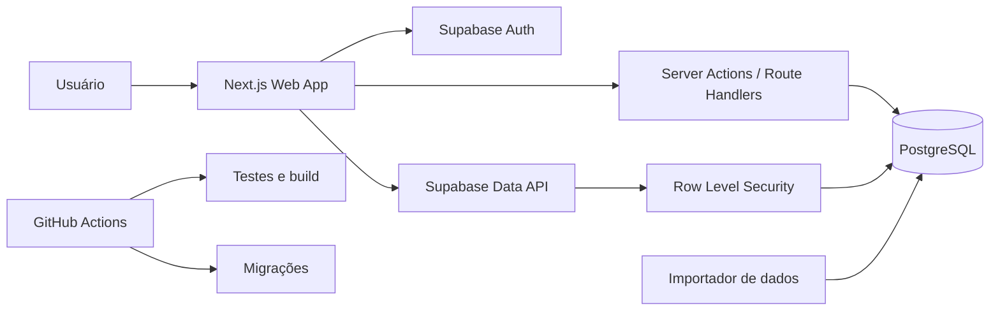

# Kepler v2 — Blueprint técnico e de produto

> Documento de passagem de contexto para iniciar uma nova implementação do
> Kepler/GradeWeb. Ele foi escrito para ser entregue a outro agente de código sem
> depender do histórico desta conversa ou da base legada.

**Status:** proposta para implementação

**Data de referência:** 2026-11-06

**Idioma do produto:** português do Brasil
**Público inicial:** estudantes da Faculdade do Gama da Universidade de Brasília

---

## 1. Instrução para o agente que receber este documento

Você deve construir uma nova versão do Kepler a partir deste blueprint. Antes de
implementar:

1. Leia o documento inteiro.
2. Inspecione os arquivos legados indicados na seção 25, caso estejam disponíveis.
3. Verifique as versões atuais das ferramentas nas documentações oficiais.
4. Registre qualquer decisão que altere o escopo em `docs/decisions/` como ADR.
5. Construa primeiro uma fatia vertical completa: autenticação, curso, catálogo,
   seleção de uma turma e visualização da grade.
6. Não implemente funcionalidades futuras antes de os critérios do MVP passarem.
7. Não copie a arquitetura, os componentes gigantes ou o CSS fixo da aplicação
   legada.

O resultado esperado é uma aplicação utilizável, responsiva, testada e segura,
com banco versionado por migrações e documentação coerente com o comportamento
entregue.

---

## 2. Resumo executivo

O Kepler é um planejador acadêmico para estudantes da FGA/UnB. Seu objetivo é
ajudar o aluno a entender o currículo, registrar matérias concluídas, encontrar
turmas compatíveis e montar uma grade semanal sem conflitos.

O produto não realiza matrícula oficial e não substitui o SIGAA. Ele funciona
como ferramenta de planejamento e apoio à decisão.

### Proposta de valor

> Em vez de comparar manualmente fluxogramas, pré-requisitos, ofertas e códigos
> de horário, o aluno informa seu curso e seu progresso e recebe uma visão clara
> das disciplinas elegíveis, dos conflitos e da grade planejada.

### Resultado principal do MVP

Um estudante autenticado deve conseguir:

1. escolher seu curso;
2. marcar disciplinas concluídas;
3. visualizar disciplinas disponíveis e seus pré-requisitos;
4. pesquisar ofertas de turma;
5. adicionar e remover turmas;
6. receber bloqueio ou aviso de conflito;
7. visualizar e manter uma grade semanal salva.

### Origem conceitual do produto

O ponto de partida do Kepler foi o template público
[Template Fluxo Eng. Software](https://grass-quarter-2f5.notion.site/Template-Fluxo-Eng-software-57a10a8a5f66497ea3bcf160e5d9bcaf),
criado por João Gabriel de Matos para estudantes de Engenharia de Software da
UnB. Essa referência deve constar na documentação e nos créditos do projeto. Ela
é uma inspiração de produto e de modelo de informação; não autoriza copiar
textos, imagens ou a base de dados sem verificar licença e permissão.

O template mostra que o problema original não é somente desenhar o fluxograma.
Ele transforma o currículo em um sistema pessoal de acompanhamento e decisão.
A base relaciona cada disciplina com:

- semestre recomendado no fluxo;
- semestre em que o aluno realmente a cursou;
- tipo: obrigatória, optativa, extensão ou módulo livre;
- créditos;
- estado: não cursada, cursando ou concluída;
- pré-requisitos, dependentes e correquisitos;
- quantidade de reprovações;
- indicação calculada de liberada ou bloqueada;
- indicação de atenção baseada nas tentativas anteriores.

A mesma base é apresentada por visões diferentes: fluxo geral por semestre,
disciplinas concluídas, não concluídas, disciplinas com requisitos cumpridos,
reprovações e matérias em curso. Essa é uma decisão importante para a v2: deve
existir uma única fonte de dados e várias projeções úteis, sem duplicar matérias
entre páginas.

As fontes declaradas no template são o Projeto Pedagógico do Curso, o
fluxograma e o SIGAA. A v2 deve preservar essa preocupação com procedência,
registrando a origem e a vigência de currículos, requisitos e ofertas. Havendo
divergência, uma fonte institucional vigente tem precedência, e a divergência
deve ficar registrada para revisão.

A tese de produto pode ser expressa assim: **preservar a clareza e a flexibilidade
do template do Notion, eliminar sua manutenção manual e acrescentar dados
versionados, contas individuais, ofertas reais, detecção de conflitos e uma
grade semanal**. A primeira versão valida isso em Engenharia de Software; o
modelo de dados permite ampliar para os demais cursos sem copiar telas ou regras.

---

## 3. Decisão de reconstrução

O Kepler v2 deve ser uma implementação nova. A base anterior serve como fonte de
requisitos, dados e lições, não como fundação arquitetural.

### Reaproveitar

- Conceito e problema de produto.
- Nome Kepler ou GradeWeb, após escolher uma identidade única.
- Catálogo legado de 267 ofertas de turma.
- As 152 disciplinas identificadas no catálogo legado.
- Os cinco cursos: Aeroespacial, Automotiva, Eletrônica, Energia e Software.
- Regras e exemplos de códigos de horário.
- Conteúdo curricular dos fluxogramas, após validação.
- Documentos de visão, escopo e arquitetura como material histórico.

### Reescrever

- Frontend.
- Modelo de banco de dados.
- Autenticação e autorização.
- Importação e normalização dos dados.
- Fluxogramas curriculares.
- Seleção de turmas e grade.
- Testes.
- Documentação operacional e arquitetural.

---

## 4. Stack recomendada

### Aplicação

- **Next.js com App Router**.
- **TypeScript com modo estrito**.
- **React** na versão suportada pelo Next.js escolhido.
- **Supabase/PostgreSQL** para dados, autenticação e políticas por linha.
- **CSS Modules, Tailwind CSS ou outro sistema único**, escolhido no bootstrap.
- **Zod** para validação nas fronteiras da aplicação.
- **React Hook Form** para formulários, se necessário.

### Qualidade

- **Vitest** para regras de domínio.
- **Testing Library** para componentes e formulários.
- **Playwright** para jornadas críticas.
- **ESLint** e formatter automático.
- **GitHub Actions** para typecheck, lint, testes e build.

### Deploy sugerido

- Aplicação Next.js: Vercel ou plataforma equivalente.
- Banco e autenticação: Supabase.
- Migrações e seed: Supabase CLI no repositório.

### Alternativa, se o objetivo for destacar backend Python

- React + Vite + TypeScript.
- FastAPI.
- PostgreSQL.
- SQLAlchemy e Alembic.
- Autenticação própria ou provedor dedicado.

A alternativa Python aumenta o número de serviços e o trabalho operacional. Use-a
somente se construir e demonstrar uma API Python for um objetivo explícito.

---

## 5. Princípios do produto

1. **Verdade antes de sugestão:** nunca apresentar como válida uma combinação que
   tenha conflito conhecido ou pré-requisito não cumprido.
2. **Explicabilidade:** toda recomendação deve explicar por que uma disciplina está
   disponível, bloqueada ou recomendada.
3. **Controle do aluno:** sugestões não devem alterar a grade automaticamente.
4. **Dados acadêmicos versionados:** currículo e oferta pertencem a um período
   letivo e não devem ser sobrescritos sem histórico.
5. **Privacidade por padrão:** cada usuário acessa somente os próprios registros.
6. **Mobile funcional:** o aluno deve consultar a grade pelo celular, ainda que a
   edição avançada seja mais confortável em telas maiores.
7. **Escopo honesto:** documentação e interface só devem anunciar funcionalidades
   entregues.

---

## 6. Personas

### P1 — Estudante iniciando o curso

- Ainda não conhece os códigos de horário.
- Quer entender a sequência recomendada de disciplinas.
- Precisa saber quais matérias pertencem a cada semestre.

### P2 — Estudante com fluxo irregular

- Possui reprovações, trancamentos ou matérias de semestres diferentes.
- Precisa identificar o que pode cursar agora.
- Quer evitar conflitos ao combinar turmas.

### P3 — Estudante próximo da conclusão

- Precisa identificar pendências curriculares.
- Quer combinar poucas disciplinas, optativas ou atividades restantes.
- Precisa de uma visão de progresso confiável.

### P4 — Administrador de dados

- Importa oferta de um novo semestre.
- Corrige curso, disciplina, turma, horário ou pré-requisito.
- Precisa visualizar erros de importação e manter rastreabilidade.

O painel administrativo não precisa fazer parte da primeira interface pública. A
administração inicial pode ocorrer por scripts e migrações revisadas.

---

## 7. Escopo do MVP

### Incluído

- Cadastro, login, logout e recuperação de acesso.
- Perfil mínimo com nome e curso.
- Catálogo de cursos e disciplinas.
- Fluxograma curricular orientado por dados.
- Registro de disciplinas concluídas.
- Registro de disciplinas não iniciadas, em curso e concluídas.
- Registro manual do semestre real e de reprovações/tentativas.
- Identificação de disciplinas elegíveis.
- Catálogo de ofertas por período letivo.
- Filtros por curso, disciplina, professor, dia e horário.
- Seleção e remoção de ofertas.
- Detecção de choque de horários.
- Grade semanal persistida por usuário.
- Estado vazio, carregamento, erro e confirmação nas jornadas críticas.
- Layout responsivo e navegação por teclado.

### Fora do MVP

- Matrícula oficial no SIGAA.
- Sincronização automática com histórico acadêmico.
- Controle de presença/faltas.
- Projetos de extensão e créditos complementares.
- Rede social, avaliações de professores ou comentários.
- Recomendação por inteligência artificial.
- Notificações push.
- Aplicativo móvel nativo.
- Múltiplas instituições de ensino.

---

## 8. Requisitos funcionais

### Conta e perfil

- **RF-001:** criar conta com e-mail e senha.
- **RF-002:** autenticar e encerrar sessão.
- **RF-003:** recuperar acesso por e-mail.
- **RF-004:** selecionar um dos cursos suportados.
- **RF-005:** editar nome e curso.
- **RF-006:** impedir acesso a dados de outro usuário.

### Currículo e progresso

- **RF-010:** listar disciplinas do currículo do curso por semestre recomendado.
- **RF-011:** exibir código, nome, créditos/carga e tipo da disciplina.
- **RF-012:** exibir pré-requisitos e dependências.
- **RF-013:** marcar e desmarcar disciplina concluída.
- **RF-014:** calcular percentual e créditos concluídos.
- **RF-015:** explicar por que uma disciplina ainda não está elegível.
- **RF-016:** registrar o estado pessoal da disciplina como não iniciada, em
  curso ou concluída.
- **RF-017:** distinguir o semestre recomendado pelo currículo do período real
  em que o aluno cursou a disciplina.
- **RF-018:** registrar tentativas e reprovações sem alterar a definição oficial
  da disciplina.
- **RF-019:** exibir visões derivadas do mesmo progresso: concluídas, pendentes,
  cursando, elegíveis e com reprovação.

### Oferta e grade

- **RF-020:** listar ofertas de um período letivo.
- **RF-021:** filtrar ofertas por texto, curso, professor, dia e bloco.
- **RF-022:** exibir todos os encontros semanais de uma turma.
- **RF-023:** adicionar oferta à grade do usuário.
- **RF-024:** impedir duplicação da mesma oferta na mesma grade.
- **RF-025:** detectar interseção de encontros e sinalizar conflito.
- **RF-026:** remover oferta selecionada.
- **RF-027:** persistir a grade entre sessões.
- **RF-028:** exibir grade em formato semanal.
- **RF-029:** calcular carga ou créditos selecionados.

### Dados administrativos

- **RF-030:** importar catálogo e ofertas de um arquivo versionado.
- **RF-031:** validar referências, duplicidades e códigos de horário.
- **RF-032:** produzir relatório de linhas aceitas, rejeitadas e corrigidas.
- **RF-033:** registrar fonte, versão e vigência de currículo, requisito e oferta.

---

## 9. Requisitos não funcionais

- **RNF-001:** TypeScript em modo estrito, sem `any` injustificado.
- **RNF-002:** todas as tabelas de dados pessoais protegidas por RLS.
- **RNF-003:** nenhum segredo no código ou em variáveis públicas do frontend.
- **RNF-004:** páginas principais utilizáveis a partir de 360 px de largura.
- **RNF-005:** foco visível e operação por teclado.
- **RNF-006:** contraste compatível com WCAG AA.
- **RNF-007:** erros apresentados em linguagem clara, sem stack trace.
- **RNF-008:** migrações reproduzem o banco em um ambiente vazio.
- **RNF-009:** CI bloqueia merge quando typecheck, lint, testes ou build falham.
- **RNF-010:** ações críticas possuem logs sem dados sensíveis.
- **RNF-011:** as regras de conflito e elegibilidade possuem testes unitários.
- **RNF-012:** o catálogo registra sua fonte e data de atualização.

---

## 10. Arquitetura de alto nível



### Limites de responsabilidade

- Componentes de UI apresentam dados e coletam intenção.
- Regras puras de conflito, elegibilidade e normalização ficam em módulos de
  domínio testáveis.
- Escritas sensíveis passam por Server Actions/Route Handlers ou por operações
  protegidas explicitamente por RLS.
- O PostgreSQL garante integridade referencial e unicidade.
- O importador nunca grava dados parcialmente sem relatório ou transação.

---

## 11. Estrutura sugerida do repositório

```text
kepler/
├── app/
│   ├── (public)/
│   │   ├── page.tsx
│   │   ├── login/
│   │   └── cadastro/
│   ├── (authenticated)/
│   │   ├── layout.tsx
│   │   ├── onboarding/
│   │   ├── progresso/
│   │   ├── disciplinas/
│   │   ├── ofertas/
│   │   ├── grade/
│   │   └── perfil/
│   └── auth/callback/
├── components/
│   ├── ui/
│   ├── curriculum/
│   ├── offerings/
│   └── schedule/
├── core/
│   ├── curriculum/
│   ├── schedule/
│   ├── validation/
│   └── types/
├── lib/
│   ├── supabase/
│   └── env.ts
├── scripts/
│   ├── import-legacy-data.ts
│   └── validate-catalog.ts
├── supabase/
│   ├── migrations/
│   ├── seed.sql
│   └── tests/
├── tests/
│   ├── e2e/
│   └── fixtures/
├── docs/
│   ├── decisions/
│   ├── data-dictionary.md
│   └── product.md
├── public/
├── .env.example
├── package.json
└── README.md
```

Evite criar abstrações ou pacotes internos antes de existir repetição comprovada.

---

## 12. Modelo de dados

Os nomes podem ser adaptados ao padrão do projeto, mas as relações e restrições
devem ser preservadas.

### `profiles`

| Campo | Tipo | Regra |
|---|---|---|
| `id` | uuid | PK e FK para `auth.users.id` |
| `display_name` | text | obrigatório |
| `course_id` | uuid | FK, pode ser nulo durante onboarding |
| `created_at` | timestamptz | default `now()` |
| `updated_at` | timestamptz | atualizado em alterações |

### `courses`

| Campo | Tipo | Regra |
|---|---|---|
| `id` | uuid | PK |
| `slug` | text | único; ex.: `software` |
| `name` | text | único |
| `active` | boolean | default true |

### `subjects`

| Campo | Tipo | Regra |
|---|---|---|
| `id` | uuid | PK |
| `code` | text | único; ex.: `FGA0003` |
| `name` | text | obrigatório |
| `credits` | integer | não negativo, se a fonte oferecer |
| `workload_hours` | integer | não negativo |
| `active` | boolean | default true |

### `curricula`

| Campo | Tipo | Regra |
|---|---|---|
| `id` | uuid | PK |
| `course_id` | uuid | FK |
| `name` | text | ex.: `Software 2023` |
| `effective_from` | date | início de vigência |
| `effective_to` | date | opcional |
| `active` | boolean | somente um ativo por curso, se aplicável |

### `curriculum_subjects`

| Campo | Tipo | Regra |
|---|---|---|
| `curriculum_id` | uuid | FK |
| `subject_id` | uuid | FK |
| `recommended_semester` | smallint | maior que zero |
| `requirement_type` | enum | `required`, `elective`, `optional` |
| `credits_required_group` | text | opcional |

Chave única: `(curriculum_id, subject_id)`.

O enum deve aceitar ao menos `required`, `elective`, `extension` e
`free_elective`. Se a instituição diferenciar “optativa” de “módulo livre”, não
colapse os dois conceitos.

### `subject_requirements`

| Campo | Tipo | Regra |
|---|---|---|
| `subject_id` | uuid | disciplina que será cursada |
| `required_subject_id` | uuid | disciplina relacionada |
| `requirement_kind` | enum | `prerequisite` ou `corequisite` |
| `group_key` | text | permite representar grupos AND/OR |
| `rule_type` | enum | `all_of` ou `one_of` |
| `source_reference` | text | fonte institucional da regra |
| `valid_from` | date | início de vigência, quando conhecido |
| `valid_to` | date | fim de vigência, opcional |

O MVP pode começar apenas com relações `all_of`, mas o modelo deve documentar a
limitação caso existam pré-requisitos alternativos na fonte real.

### `academic_terms`

| Campo | Tipo | Regra |
|---|---|---|
| `id` | uuid | PK |
| `code` | text | único; ex.: `2027-1` |
| `starts_at` | date | opcional |
| `ends_at` | date | opcional |
| `active` | boolean | indica período padrão da UI |

### `class_offerings`

| Campo | Tipo | Regra |
|---|---|---|
| `id` | uuid | PK |
| `legacy_id` | integer | opcional e indexado |
| `term_id` | uuid | FK |
| `subject_id` | uuid | FK |
| `section` | text | turma; preservar zeros e letras |
| `professor_name` | text | valor inicial; normalizar no futuro se necessário |
| `status` | enum | `open`, `closed`, `cancelled`, `unknown` |
| `source` | text | origem do dado |

Unicidade sugerida: `(term_id, subject_id, section)`.

### `class_meetings`

| Campo | Tipo | Regra |
|---|---|---|
| `id` | uuid | PK |
| `offering_id` | uuid | FK com cascade |
| `weekday` | smallint | ISO: 1 segunda, 2 terça, ..., 6 sábado |
| `starts_at` | time | obrigatório |
| `ends_at` | time | maior que `starts_at` |
| `campus` | text | opcional |
| `room` | text | opcional |

Uma oferta com encontros em dois dias gera duas linhas. Não armazene o código
`35T23` como única representação operacional; preserve-o somente como `raw_code`
para auditoria.

### `user_subject_progress`

| Campo | Tipo | Regra |
|---|---|---|
| `user_id` | uuid | FK para usuário |
| `subject_id` | uuid | FK |
| `status` | enum | `not_started`, `in_progress`, `completed` |
| `actual_term_id` | uuid | período real mais recente, opcional |
| `failure_count` | smallint | inteiro não negativo, default 0 |
| `completed_at` | date | obrigatório somente quando conhecido |
| `updated_at` | timestamptz | auditoria |

Chave única: `(user_id, subject_id)`.

O “semestre pelo fluxo” pertence a `curriculum_subjects`. O “semestre na
prática” pertence ao progresso do usuário. Eles não devem compartilhar o mesmo
campo, porque um é prescritivo e o outro registra a trajetória real.

Se for necessário guardar cada tentativa, crie `subject_attempts` com usuário,
disciplina, período, resultado e nota opcional. `failure_count` passa a ser uma
projeção calculada, evitando inconsistência. Não armazene uma classificação de
“risco” como verdade permanente: calcule um aviso explicável a partir das
tentativas e do impacto da disciplina na cadeia curricular.

### `study_plans`

| Campo | Tipo | Regra |
|---|---|---|
| `id` | uuid | PK |
| `user_id` | uuid | FK |
| `term_id` | uuid | FK |
| `name` | text | ex.: `Grade principal` |
| `active` | boolean | plano exibido por padrão |

### `study_plan_offerings`

| Campo | Tipo | Regra |
|---|---|---|
| `study_plan_id` | uuid | FK com cascade |
| `offering_id` | uuid | FK |
| `created_at` | timestamptz | default `now()` |

Chave única: `(study_plan_id, offering_id)`.

---

## 13. Segurança e RLS

Ative RLS em todas as tabelas que contêm `user_id` ou apontam para um plano do
usuário.

### Política de perfil

```sql
create policy "users read own profile"
on public.profiles for select
to authenticated
using ((select auth.uid()) = id);

create policy "users update own profile"
on public.profiles for update
to authenticated
using ((select auth.uid()) = id)
with check ((select auth.uid()) = id);
```

### Política de progresso acadêmico

```sql
create policy "users manage own subject progress"
on public.user_subject_progress for all
to authenticated
using ((select auth.uid()) = user_id)
with check ((select auth.uid()) = user_id);
```

### Política de planos

`study_plans` compara diretamente `user_id`. Para `study_plan_offerings`, use uma
política baseada em `exists` que confirme que o plano pertence ao usuário atual.

### Regras adicionais

- Revogue privilégios desnecessários de `anon` e `authenticated`.
- Nunca envie a service role para o navegador.
- Valide autorização no banco mesmo quando a UI oculta uma ação.
- Não grave senhas, tokens, histórico completo ou dados pessoais em logs.
- Use variáveis validadas no bootstrap e falhe cedo quando faltarem segredos.

---

## 14. Códigos de horário da UnB

O legado contém valores como `35T23`, `46M34` e combinações separadas por espaço.
A interpretação deve ser confirmada contra uma fonte oficial antes da importação
definitiva.

Hipótese de trabalho:

- Os dígitos iniciais representam dias da semana.
- `M`, `T` e `N` representam manhã, tarde e noite.
- Os dígitos posteriores representam períodos dentro do turno.
- Um código pode conter mais de um segmento.

Exemplo hipotético: `35T23` representa encontros nos dias identificados por `3` e
`5`, nos períodos `2` e `3` da tarde.

### Representação canônica

```ts
type Meeting = {
  weekday: 1 | 2 | 3 | 4 | 5 | 6;
  startsAt: string; // HH:mm
  endsAt: string;   // HH:mm
  rawCode: string;
};
```

### Regras do parser

1. Rejeitar caracteres e segmentos desconhecidos.
2. Preservar o valor original.
3. Produzir um encontro para cada combinação real de dia e intervalo.
4. Nunca reduzir um código composto a um único bloco.
5. Emitir erro de importação quando houver ambiguidade.
6. Testar todos os códigos distintos encontrados no conjunto legado.

### Detecção de conflito

Duas ofertas conflitam quando existe ao menos um par de encontros com mesmo dia e
intervalos sobrepostos:

```ts
function overlaps(a: Meeting, b: Meeting): boolean {
  return (
    a.weekday === b.weekday &&
    a.startsAt < b.endsAt &&
    b.startsAt < a.endsAt
  );
}
```

Encontros adjacentes, como `10:00–11:50` e `12:00–13:50`, não conflitam.

---

## 15. Regra de elegibilidade curricular

### Versão inicial

Uma disciplina é elegível quando:

1. pertence ao currículo ativo do curso do usuário;
2. ainda não está concluída;
3. todos os pré-requisitos obrigatórios estão concluídos;
4. cada correquisito está concluído ou foi selecionado no mesmo plano;
5. existe ao menos uma oferta no período selecionado, quando a tela estiver no
   contexto de matrícula.

### Resultado explicável

```ts
type EligibilityResult = {
  eligible: boolean;
  missingPrerequisiteCodes: string[];
  missingCorequisiteCodes: string[];
  alreadyCompleted: boolean;
  hasOfferingInTerm: boolean;
};
```

Não retorne apenas `true` ou `false`; a UI precisa explicar o resultado.

### Testes obrigatórios

- Disciplina sem pré-requisito é elegível.
- Disciplina concluída não aparece como nova sugestão.
- Falta de um pré-requisito bloqueia.
- Todos os pré-requisitos concluídos liberam.
- Correquisito concluído ou selecionado no mesmo plano libera.
- Correquisito ausente bloqueia e aparece na explicação.
- Ciclo acidental no grafo é detectado pela validação do catálogo.
- Disciplina de outro currículo não é sugerida.

---

## 16. Páginas e rotas

### Públicas

| Rota | Conteúdo |
|---|---|
| `/` | proposta, demonstração e chamada para cadastro |
| `/login` | autenticação |
| `/cadastro` | criação de conta |
| `/recuperar-senha` | recuperação de acesso |

### Autenticadas

| Rota | Conteúdo |
|---|---|
| `/onboarding` | nome e curso antes do primeiro uso |
| `/progresso` | resumo e disciplinas concluídas |
| `/fluxograma` | currículo visual por semestre |
| `/ofertas` | pesquisa e filtros de turmas |
| `/grade` | grade semanal e conflitos |
| `/perfil` | dados da conta e preferências |

### Regras de navegação

- Usuário não autenticado enviado para `/login` ao abrir rota privada.
- Usuário autenticado sem curso enviado para `/onboarding`.
- Usuário com onboarding completo abre `/grade` ou `/progresso`.
- Redirecionamentos preservam destino quando fizer sentido.
- A navegação móvel não pode depender de hover.

---

## 17. Especificação das interfaces

### Onboarding

- Campo de nome.
- Seleção entre cinco cursos.
- Explicação de que o curso pode ser alterado posteriormente.
- Ação primária “Começar planejamento”.
- Persistência antes do redirecionamento.

### Progresso

- Curso e currículo ativo.
- Créditos ou carga concluída e restante.
- Disciplinas agrupadas por semestre recomendado.
- Busca por código ou nome.
- Ação acessível para marcar/desmarcar conclusão.
- Estado editável: não iniciada, cursando e concluída.
- Período real e número de reprovações/tentativas, quando informados.
- Visões “Todas”, “Concluídas”, “Pendentes”, “Cursando”, “Elegíveis” e
  “Reprovações”, todas derivadas da mesma base.
- Comparação entre semestre ideal e trajetória real sem tratar atraso como erro.
- Aviso quando faltarem dados curriculares.

### Fluxograma

- Um único componente para todos os cursos.
- Dados vindos do banco, sem páginas copiadas por curso.
- Cartões com código, nome, créditos e estado.
- Estados: concluída, elegível, bloqueada, selecionada.
- Detalhe de pré-requisitos, correquisitos e matérias que dependem dela ao clicar
  ou focar.
- Em celular, usar lista vertical ou colunas roláveis com indicação clara.

### Ofertas

- Busca textual com debounce moderado.
- Filtros combináveis.
- Cartão ou linha com disciplina, turma, professor e encontros.
- Ação “Adicionar à grade”.
- Estado explícito quando já selecionada.
- Motivo visível quando houver conflito.
- URL pode refletir filtros para permitir compartilhamento da consulta.

### Grade

- Colunas por dia e eixo temporal consistente.
- Alternativa textual/lista para acessibilidade e celular.
- Cor não pode ser o único indicador.
- Remoção de turma disponível no cartão e na lista.
- Resumo de carga e quantidade de disciplinas.
- Conflitos destacados e explicados.
- Estado vazio com link para ofertas.

---

## 18. Importação dos dados legados

O arquivo legado principal contém:

- 267 registros de oferta;
- identificadores de `0` a `266`;
- 152 códigos distintos de disciplina;
- cinco cursos;
- campos de curso repetidos (`curso`, `curso2`, ..., `curso5`);
- uma chave vazia em alguns objetos;
- horários ainda não normalizados.

### Pipeline

1. Ler JSON como entrada imutável.
2. Validar o schema bruto com Zod.
3. Remover chave vazia e espaços inconsistentes.
4. Normalizar nomes de curso, inclusive `Eletronica` → `Eletrônica` na apresentação.
5. Deduplicar disciplinas por código.
6. Criar relações N:N entre disciplina e curso.
7. Criar ofertas com `legacy_id`.
8. Interpretar horários e criar `class_meetings`.
9. Produzir relatório de importação.
10. Gravar em transação somente se não houver erros críticos.

### Relatório esperado

```json
{
  "sourceRecords": 267,
  "subjectsCreated": 152,
  "offeringsCreated": 267,
  "meetingsCreated": 0,
  "warnings": [],
  "errors": []
}
```

O valor de `meetingsCreated` acima é ilustrativo; o teste deve exigir a contagem
real calculada pelo parser.

### Dados que exigem nova fonte

- Pré-requisitos confiáveis.
- Créditos e carga oficial por currículo.
- Semestre recomendado.
- Natureza obrigatória/optativa.
- Vigência do currículo.
- Período letivo da oferta legada.
- Salas e campus, se forem exibidos.

Não inferir esses campos silenciosamente.

---

## 19. Operações de servidor

As assinaturas são conceituais.

```ts
updateProfile(input)
listCurriculum(courseId)
setSubjectCompletion(subjectId, completed)
listEligibleSubjects(termId)
searchOfferings(filters)
createStudyPlan(termId, name)
addOfferingToPlan(planId, offeringId)
removeOfferingFromPlan(planId, offeringId)
getWeeklySchedule(planId)
```

### `addOfferingToPlan`

1. Autenticar usuário.
2. Confirmar que o plano pertence ao usuário.
3. Confirmar que oferta e período existem.
4. Impedir duplicidade.
5. Carregar encontros já selecionados.
6. Detectar conflitos.
7. Retornar erro de domínio explicável ou persistir.
8. Revalidar páginas afetadas.

O banco continua responsável pela autorização final via RLS e por restrições de
unicidade.

---

## 20. Estratégia de testes

### Unidade

- Parser de horários.
- Interseção de encontros.
- Elegibilidade e pré-requisitos.
- Correquisitos concluídos ou selecionados no mesmo plano.
- Cálculo de progresso.
- Projeções de concluídas, cursando, pendentes, elegíveis e reprovações.
- Normalização dos dados legados.
- Validação de variáveis de ambiente.

### Integração

- Migração em banco vazio.
- Políticas RLS com dois usuários diferentes.
- Criação de perfil após cadastro.
- Adição e remoção de oferta.
- Restrição única de seleção.
- Importador idempotente ou explicitamente versionado.

### Componentes

- Formulários com mensagens de validação.
- Filtros de oferta.
- Estados do cartão de disciplina.
- Grade com estado vazio e conflitos.
- Navegação por teclado.

### E2E

1. Cadastrar → escolher curso → abrir progresso.
2. Marcar pré-requisito → disciplina dependente torna-se elegível.
3. Marcar disciplina em curso → ela aparece na visão “Cursando”.
4. Informar reprovação → tentativa aparece somente para o próprio usuário.
5. Selecionar correquisito → disciplina relacionada torna-se elegível no plano.
6. Buscar oferta → adicionar → visualizar na grade.
7. Tentar adicionar oferta conflitante → visualizar explicação.
8. Remover oferta → conflito desaparece.
9. Usuário A não consegue acessar plano do usuário B.
10. Atualizar página → grade permanece salva.

### Dados de teste

Crie um conjunto pequeno e determinístico, separado do catálogo completo:

- dois cursos;
- seis disciplinas;
- três relações de pré-requisito;
- oito ofertas;
- dois conflitos intencionais;
- dois usuários.

---

## 21. Critérios de aceite do MVP

O MVP estará pronto quando:

- [ ] Um ambiente novo sobe seguindo apenas o README.
- [ ] Migrações e seed terminam sem intervenção manual.
- [ ] Cadastro, confirmação aplicável, login e logout funcionam.
- [ ] Cada usuário vê somente seus dados.
- [ ] Os cinco cursos podem ser selecionados.
- [ ] O fluxo curricular é gerado a partir do banco.
- [ ] O usuário marca disciplinas concluídas.
- [ ] O usuário registra disciplina em curso, semestre real e reprovação.
- [ ] As visões de progresso usam a mesma fonte e exibem resultados coerentes.
- [ ] Pré-requisitos alteram a elegibilidade corretamente.
- [ ] Correquisitos consideram conclusão e seleção simultânea no plano.
- [ ] O catálogo de ofertas possui pesquisa e filtros combináveis.
- [ ] Uma oferta pode ser adicionada e removida.
- [ ] Conflitos são detectados em todos os encontros da oferta.
- [ ] A grade permanece após logout/login.
- [ ] As jornadas críticas funcionam em 360 px e desktop.
- [ ] Não existem erros de typecheck, lint ou build.
- [ ] Testes de domínio e E2E críticos passam na CI.
- [ ] `npm audit` não apresenta vulnerabilidade crítica de produção sem decisão registrada.
- [ ] A documentação descreve exatamente o comportamento entregue.
- [ ] A origem conceitual e as fontes institucionais aparecem nos créditos.

---

## 22. Fases de implementação

### Fase 0 — Fundação

- Criar repositório e projeto Next.js TypeScript.
- Configurar lint, formatter, testes e CI.
- Criar projeto Supabase e clientes server/browser.
- Configurar validação de ambiente.
- Criar README executável.

### Fase 1 — Identidade e segurança

- Migrações de cursos e perfis.
- Cadastro, login, logout e callback.
- Onboarding de curso.
- RLS e testes com dois usuários.

### Fase 2 — Catálogo curricular

- Modelar disciplinas, currículos e pré-requisitos.
- Seed pequeno validado.
- Página de progresso.
- Motor de elegibilidade.

### Fase 3 — Ofertas e horários

- Modelar termos, ofertas e encontros.
- Criar parser e importador.
- Importar catálogo legado.
- Criar busca e filtros.

### Fase 4 — Planejamento

- Criar planos e seleções.
- Implementar conflitos.
- Construir grade semanal e alternativa em lista.
- Persistência e E2E da jornada principal.

### Fase 5 — Fluxograma e acabamento

- Construir fluxograma orientado por dados.
- Ajustar responsividade e acessibilidade.
- Estados de erro e observabilidade.
- Revisar documentação e preparar demonstração.

Cada fase deve terminar utilizável e com testes. Não acumule integração para o
fim.

---

## 23. Definition of Done

Uma tarefa só está concluída quando:

- comportamento e critérios de aceite estão claros;
- código possui tipos adequados;
- estado de carregamento, vazio e erro foi considerado;
- autorização foi verificada;
- teste proporcional ao risco foi adicionado;
- acessibilidade básica foi verificada;
- documentação afetada foi atualizada;
- CI passa;
- não há segredo ou dado pessoal em logs, fixtures ou commits.

---

## 24. Decisões que ainda precisam ser tomadas

1. Nome público definitivo: **Kepler** ou **GradeWeb**.
2. Fonte oficial e licença dos dados curriculares.
3. Currículo e período de referência para cada curso.
4. Tabela oficial de conversão dos códigos de horário.
5. Conflito deve bloquear ou apenas exigir confirmação?
6. Uma pessoa poderá manter mais de um plano no mesmo período?
7. Cadastro será liberado para qualquer e-mail ou apenas domínio institucional?
8. Confirmação de e-mail será obrigatória no MVP?
9. Tailwind, CSS Modules ou biblioteca visual existente?
10. Local de hospedagem e limites do plano gratuito.
11. Quais dados do template do Notion podem ser reutilizados e sob qual licença?
12. Reprovações serão um contador manual no MVP ou um histórico por tentativa?

Registre cada escolha relevante como ADR curta.

---

## 25. Fontes legadas disponíveis

### Referência que originou o produto

- [Template Fluxo Eng. Software no Notion](https://grass-quarter-2f5.notion.site/Template-Fluxo-Eng-software-57a10a8a5f66497ea3bcf160e5d9bcaf):
  referência conceitual criada por João Gabriel de Matos. Em 2026-11-06, a
  estrutura pública continha fluxo por semestre, estados pessoais, créditos,
  tipos de disciplina, pré e correquisitos, dependências, reprovações, cálculo
  de elegibilidade e visões filtradas.
- Fontes acadêmicas citadas pelo próprio template: Projeto Pedagógico do Curso,
  fluxograma e SIGAA. Localize e versione os documentos institucionais vigentes
  antes de publicar dados como oficiais.

O link do Notion pode mudar ou deixar de estar público. Registre as regras
validadas em documentos e seeds versionados no repositório; não transforme a
página externa em dependência de execução da aplicação.

### Repositório Kepler legado

Se o repositório antigo estiver acessível, consulte:

- `frontend/src/data/turmas-professores.json`: catálogo combinado principal.
- `frontend/src/data/TurmasJson.json`: dados auxiliares de turmas.
- `backend/Materia.csv` e `backend/MateriaJson.json`: catálogo de disciplinas.
- `backend/Turmas.csv` e `backend/TurmasJson.json`: turmas em formatos alternativos.
- `frontend/src/pages/Fluxograma*.js`: conteúdo visual dos cinco cursos.
- `frontend/src/utils/schedule.js`: tentativa inicial de normalização de horários.
- `docs/Visao.md`: visão histórica.
- `docs/Escopo.md`: backlog e histórias históricas.
- `docs/arquitetura.md`: arquitetura histórica; não usar como arquitetura da v2.
- `AtasDasReunioes/`: contexto de decisões da equipe original.

### Avisos sobre o legado

- Os fluxogramas foram codificados manualmente e podem estar desatualizados.
- O catálogo não identifica claramente o período letivo.
- A regra antiga agrupava códigos compostos em faixas amplas e não deve ser
  considerada fonte oficial.
- Documentos divergem entre SQLite, PostgreSQL e MySQL.
- Funcionalidades descritas nos documentos não foram necessariamente entregues.

---

## 26. Coisas que o novo projeto não deve repetir

- Uma página de fluxograma diferente para cada curso.
- Centenas de estilos inline.
- Larguras fixas como 1520 px ou 2450 px.
- URLs de API espalhadas nos componentes.
- Token manipulado manualmente em vários arquivos.
- Dados do usuário sem chave estrangeira para o proprietário.
- Acesso ao catálogo por caminho relativo ao diretório de execução.
- Artefatos gerados, ambiente virtual ou `node_modules` versionados.
- Site compilado duplicado no Git.
- Documentação que promete funcionalidades futuras como existentes.
- Testes criados apenas no final.
- Uma chave de horário mapeada para somente um bloco quando possui vários encontros.

---

## 27. Roadmap posterior ao MVP

Priorize com evidência de uso:

1. Comparação entre dois planos de grade.
2. Exportação para calendário `.ics`.
3. Compartilhamento somente leitura de uma grade.
4. Importação assistida de histórico.
5. Optativas e grupos de créditos.
6. Recomendações considerando carga e janelas entre aulas.
7. Atualização semestral assistida do catálogo.
8. Projetos de extensão.
9. Controle de frequência.

Não iniciar por inteligência artificial. Primeiro construa dados confiáveis e
regras determinísticas explicáveis.

---

## 28. Checklist de bootstrap para outro agente

- [ ] Confirmar decisões abertas indispensáveis.
- [ ] Criar projeto Next.js com TypeScript estrito.
- [ ] Definir Node suportado em `.nvmrc` ou equivalente.
- [ ] Criar `.env.example` sem valores secretos.
- [ ] Configurar Supabase local.
- [ ] Criar primeira migração: cursos e perfis.
- [ ] Criar RLS antes da primeira funcionalidade autenticada.
- [ ] Adicionar dois testes de isolamento entre usuários.
- [ ] Configurar CI.
- [ ] Criar layout público e autenticado.
- [ ] Implementar cadastro/login/onboarding.
- [ ] Entregar a primeira fatia vertical antes de importar o catálogo completo.

---

## 29. Prompt pronto para iniciar outra conversa

Copie o texto abaixo e anexe este arquivo ao novo chat:

```text
Quero construir o Kepler v2. O arquivo KEPLER_V2_BLUEPRINT.md é a fonte
principal de requisitos, arquitetura e critérios de aceite.

Leia o documento inteiro antes de agir. Em seguida:
1. faça uma análise crítica curta das decisões propostas;
2. identifique apenas os bloqueios que realmente exigem minha escolha;
3. adote as recomendações do documento para os demais pontos;
4. crie a fundação do repositório;
5. implemente a Fase 0 e a primeira fatia vertical da Fase 1;
6. configure testes e CI desde o início;
7. execute todas as verificações e documente como rodar localmente.

Não copie a arquitetura do projeto legado. Use o legado somente como fonte de
dados e comportamento. Não implemente funcionalidades fora do MVP sem concluir
os critérios anteriores. Preserve segurança por usuário no banco com RLS.
```

---

## 30. Visão de sucesso

O Kepler v2 será bem-sucedido quando um estudante conseguir abrir a aplicação,
informar seu curso e progresso, encontrar turmas possíveis e montar uma grade sem
precisar compreender a estrutura interna dos códigos ou comparar manualmente
várias fontes.

Para o portfólio, o projeto deve demonstrar:

- entendimento de um problema real;
- modelagem relacional;
- autenticação e autorização corretas;
- regras de domínio testadas;
- importação e qualidade de dados;
- interface responsiva e acessível;
- documentação coerente;
- capacidade de entregar um produto completo, e não apenas telas isoladas.
