# Integração e entrega contínuas

O GitHub Actions já publica esta documentação no GitHub Pages. A aplicação ainda precisa de uma esteira própria antes de ser tratada como pronta para implantação.

## Estado atual

| Verificação | Documentação | Aplicação |
|---|---:|---:|
| Build reproduzível | Sim | Pendente |
| Publicação automática | Sim, GitHub Pages | Pendente |
| Typecheck e lint | Não se aplica ao conteúdo | Pendente |
| Testes unitários | Pendente para exemplos executáveis | Pendente |
| Testes de integração | Não se aplica | Pendente |
| Migração em banco vazio | Não se aplica | Pendente |
| Verificação de segredos | Pendente | Pendente |

## Pipeline alvo

```mermaid
flowchart LR
    C[Commit ou pull request] --> I[Instalar dependências fixadas]
    I --> T[Typecheck e lint]
    T --> U[Testes unitários]
    U --> DB[Testes de integração e migrações]
    DB --> B[Build frontend e API]
    B --> D[Build estrito da documentação]
    D --> S[Verificações de segurança]
    S --> A[Artefatos versionados]
    A --> STG[Ambiente de homologação]
    STG --> E2E[Testes de jornada]
    E2E --> PRD[Produção com aprovação]
```

## Portões de qualidade

| Portão | Condição de aprovação |
|---|---|
| Código | tipagem, lint e formatação sem erros |
| Domínio | testes de conflito, elegibilidade e progresso aprovados |
| Dados | migração sobe um banco vazio e rollback é ensaiado |
| Segurança | dependências e segredos verificados; teste de isolamento aprovado |
| Interface | build concluído; jornada crítica e acessibilidade sem bloqueios |
| Documentação | `mkdocs build --strict` concluído |

## Ambientes

| Ambiente | Origem | Dados | Objetivo |
|---|---|---|---|
| Desenvolvimento | branch local | sintéticos | retorno rápido |
| Preview | pull request | sintéticos e isolados | revisão funcional |
| Homologação | branch principal aprovada | catálogo controlado | validar migração e jornadas |
| Produção | release versionada | dados oficiais | uso real e observabilidade |

## Política de implantação

- imagens, builds e migrações recebem a mesma versão da release;
- a migração executa antes da ativação do código que depende dela;
- alterações incompatíveis usam expansão, migração de dados e contração em releases separadas;
- falha em smoke test interrompe a promoção;
- rollback recupera a versão anterior do serviço e respeita a compatibilidade do banco;
- artefatos e relatórios da pipeline permanecem associados ao commit.

## Evidências por entrega

- link da execução do GitHub Actions;
- versão do artefato e hash do commit;
- relatório de testes e cobertura de regras críticas;
- resultado da migração em ambiente vazio;
- relatório de acessibilidade e jornada principal;
- registro de implantação ou rollback.

## Próximos incrementos

1. adicionar typecheck, lint e build do frontend;
2. criar testes de domínio para conflito e elegibilidade;
3. subir PostgreSQL efêmero e aplicar todas as migrações;
4. testar autorização com duas identidades;
5. gerar artefatos versionados e preview por pull request;
6. configurar homologação e promoção controlada.
