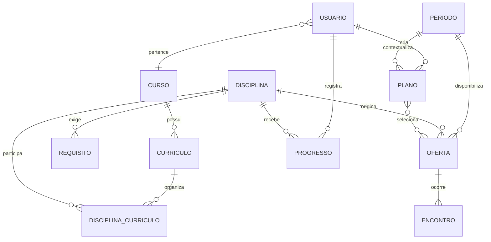
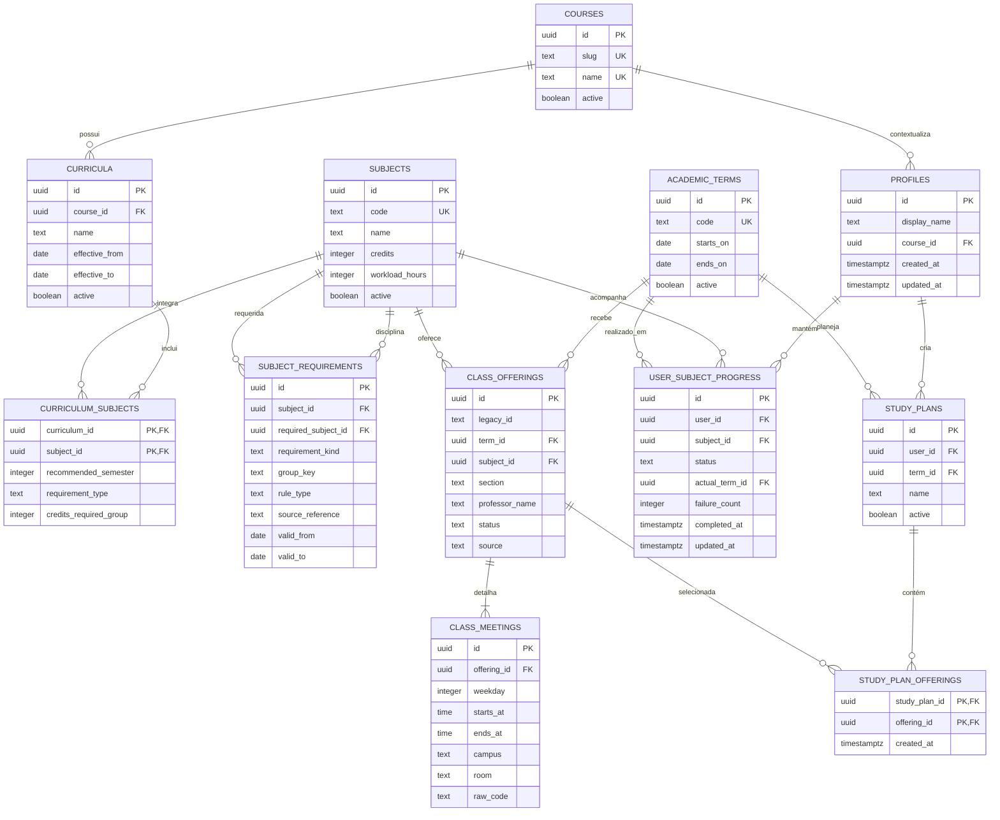

# Modelagem de dados

A modelagem segue a profundidade usada pelo **CHEF Indica**: visão conceitual, modelo lógico, decisões físicas e regras de integridade. No KEPLER, este é um **modelo alvo**. O protótipo ainda mantém dados em memória e deve migrar de forma incremental.

## Visão conceitual



O período recomendado no currículo representa a posição ideal da disciplina. O período real pertence ao progresso do estudante. Manter esses conceitos separados evita alterar o currículo para acomodar trajetórias individuais.

## Modelo lógico



## Decisões do modelo físico

| Decisão | Regra |
|---|---|
| Identificadores | UUID para entidades persistentes; códigos acadêmicos continuam como chaves naturais únicas |
| Datas | `date` para vigência e `timestamptz` para auditoria |
| Horários | dia da semana entre 1 e 6; início menor que término |
| Exclusão | registros acadêmicos são inativados ou encerram vigência; dados pessoais seguem política própria |
| Multiplicidade | uma oferta possui um ou mais encontros; um plano não repete a mesma oferta |
| Histórico | fonte, referência e vigência são preservadas quando a regra pode mudar |
| Privacidade | tabelas pessoais filtram `user_id` pela identidade autenticada |

## Restrições essenciais

```sql
alter table class_meetings
  add constraint valid_weekday check (weekday between 1 and 6),
  add constraint valid_interval check (starts_at < ends_at);

alter table user_subject_progress
  add constraint unique_user_subject unique (user_id, subject_id);

alter table study_plan_offerings
  add constraint unique_plan_offering unique (study_plan_id, offering_id);

alter table class_offerings
  add constraint unique_term_subject_section
  unique (term_id, subject_id, section);
```

Conflitos de horário dependem de vários encontros e devem ser validados no domínio dentro da mesma transação da inclusão. Uma restrição simples de linha não cobre esse caso.

## Índices iniciais

```sql
create index idx_offerings_term_subject
  on class_offerings (term_id, subject_id);

create index idx_meetings_offering_weekday
  on class_meetings (offering_id, weekday, starts_at);

create index idx_progress_user_status
  on user_subject_progress (user_id, status);

create index idx_requirements_subject_validity
  on subject_requirements (subject_id, valid_from, valid_to);
```

Os índices devem ser confirmados por consultas reais e planos de execução. Índices adicionais sem evidência aumentam o custo de escrita e manutenção.

## Isolamento dos dados pessoais

```sql
alter table study_plans enable row level security;

create policy study_plans_by_owner
on study_plans
using (user_id = auth.uid())
with check (user_id = auth.uid());
```

A mesma política deve cobrir progresso e itens do plano, inclusive acessos feitos por junção. A API também valida a identidade; a política no banco atua como segunda barreira.

## Ordem de migração

1. curso, disciplina, período e currículo;
2. relações curriculares e requisitos;
3. ofertas e encontros;
4. perfil e progresso individual;
5. planos e ofertas selecionadas;
6. políticas de acesso, índices e dados de referência;
7. importação versionada e verificação de integridade.

## Critérios de validação

- o banco é criado a partir de zero somente com migrações versionadas;
- duas execuções da mesma importação produzem o mesmo resultado;
- requisitos inválidos ou circulares aparecem no relatório;
- dois usuários não conseguem consultar nem alterar dados um do outro;
- cada registro importado pode ser associado à fonte e à versão.
