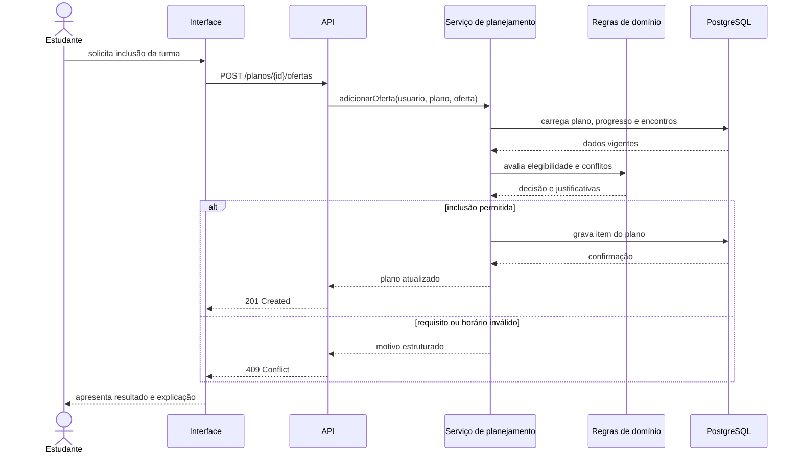
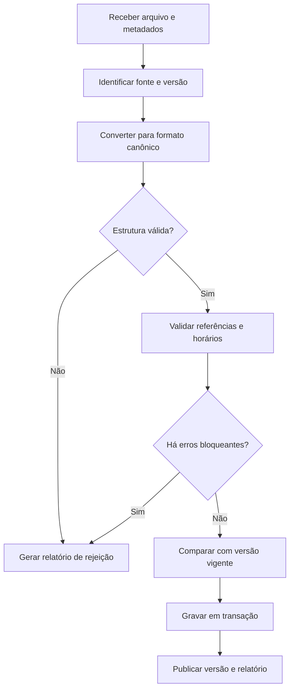
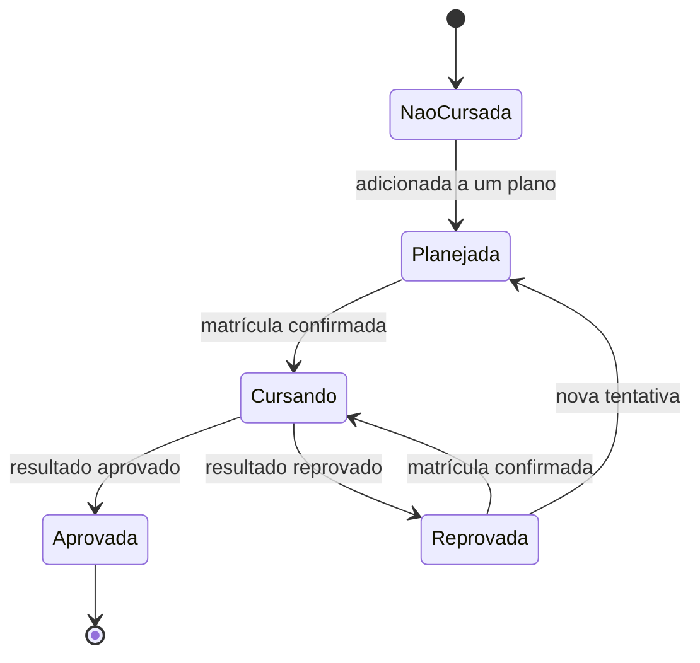
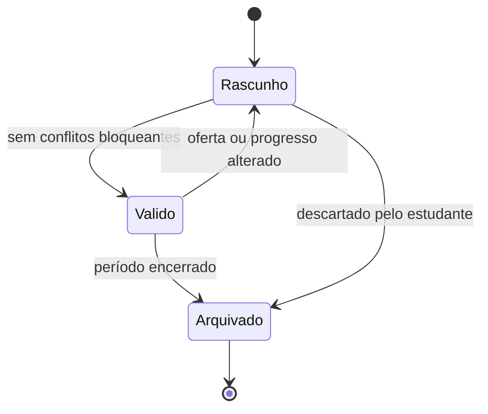

# Modelagem dinâmica

Os modelos dinâmicos descrevem como atores e componentes colaboram nos fluxos de maior risco. Eles servem como base para critérios de aceite e testes de integração.

## Atores e casos de uso

| Ator | Casos de uso principais |
|---|---|
| Estudante | consultar currículo, registrar progresso, avaliar elegibilidade e montar grade |
| Administrador de dados | importar, validar e publicar catálogo acadêmico |
| Provedor de identidade | autenticar e fornecer a identidade confiável |
| Pipeline de entrega | verificar código, publicar documentação e implantar versões aprovadas |

## Adicionar uma turma ao plano

O servidor repete as validações mesmo que a interface antecipe o resultado. A resposta deve indicar quais requisitos faltam ou quais encontros se sobrepõem.

## Importar dados acadêmicos

Uma falha bloqueante encerra a transação. Avisos podem ser publicados no relatório sem ocultar a origem do dado.

## Estado de uma disciplina para o estudante

Alterações manuais precisam registrar data, origem e usuário responsável. Uma disciplina aprovada só deve voltar a outro estado por uma operação explícita e auditável.

## Ciclo de um plano de estudos

## Colaboração por responsabilidade

| Passo | Interface | Aplicação | Domínio | Dados |
|---|---|---|---|---|
| Consultar currículo | solicita e apresenta | seleciona versão vigente | calcula progresso | preserva relações e vigência |
| Avaliar disciplina | mostra justificativa | reúne contexto | decide elegibilidade | fornece requisitos e histórico |
| Montar grade | permite intenção | coordena alteração | detecta conflito | garante unicidade |
| Importar catálogo | mostra relatório | controla transação | valida regras canônicas | registra fonte e versão |

## Cobertura de testes sugerida

- teste unitário para interseção de horários e grupos `all_of`/`one_of`;
- teste de integração para gravação atômica do plano;
- teste com dois usuários para impedir leitura cruzada;
- teste de contrato para erros estruturados da API;
- teste de importação repetida para comprovar idempotência.
