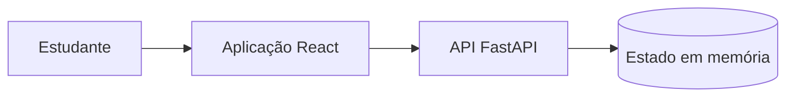
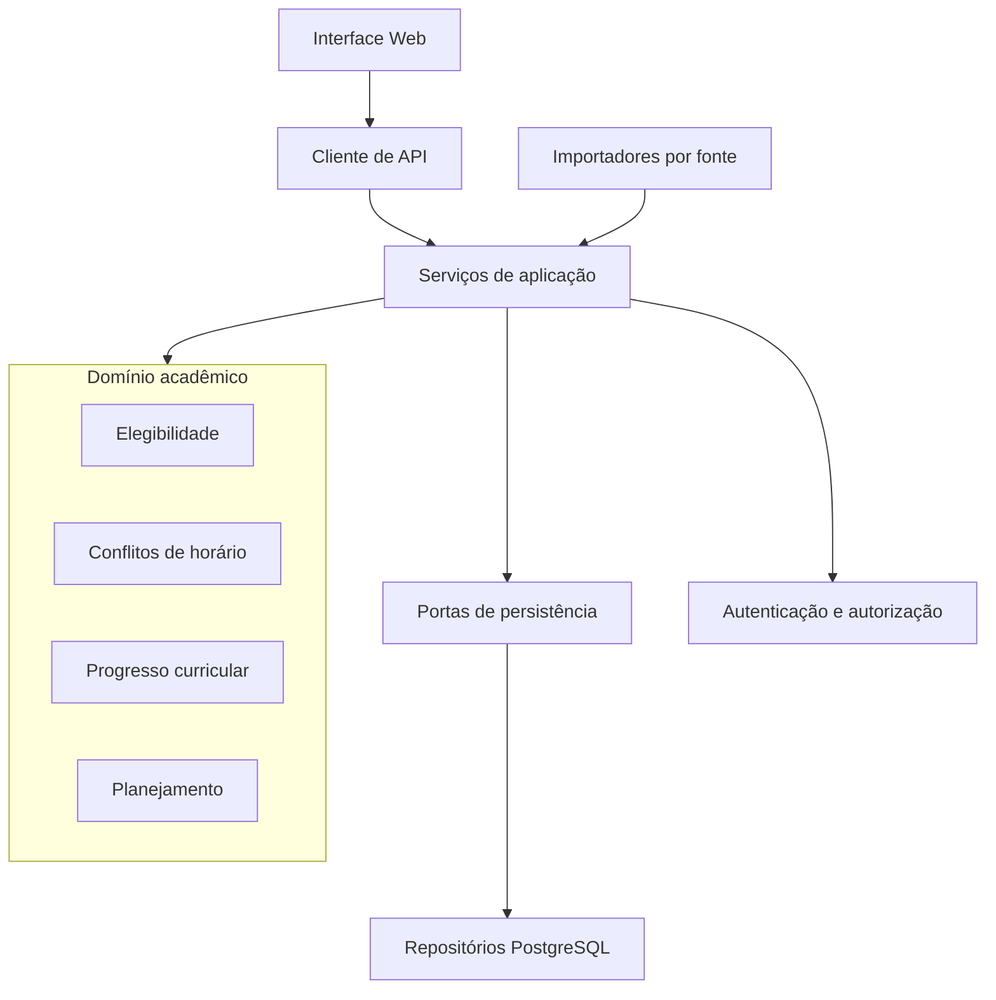
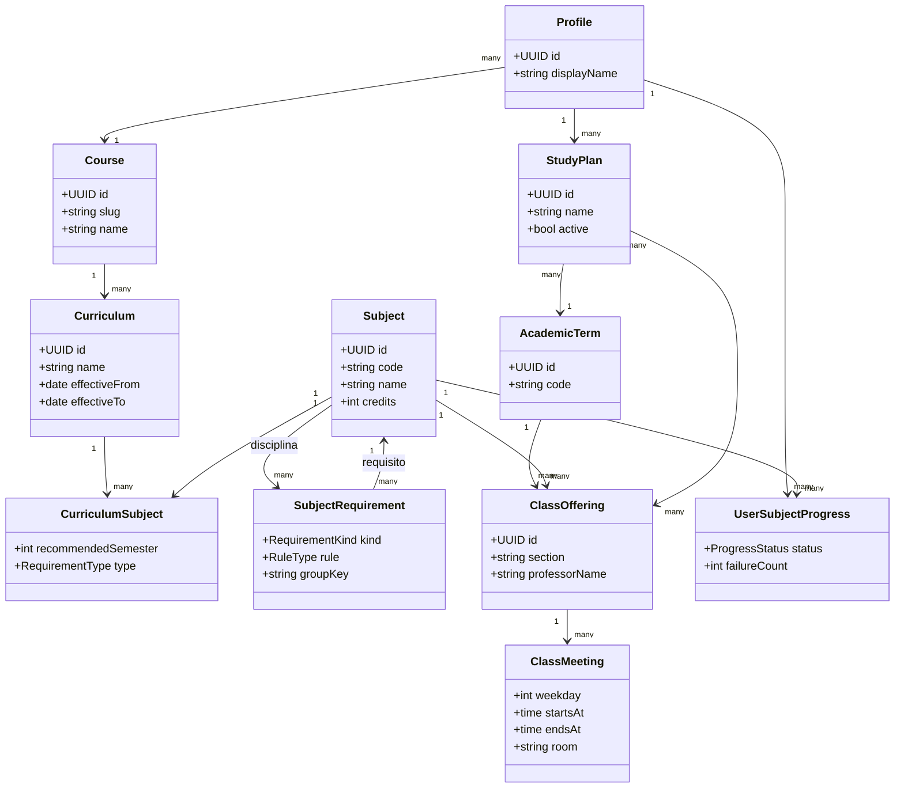
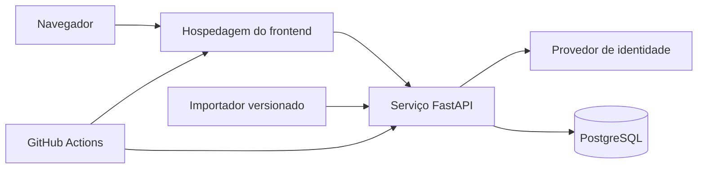

# Modelagem estática

Esta página apresenta a estrutura lógica do KEPLER. Os diagramas separam o **protótipo atual**, observado no código, da **arquitetura alvo**, definida para orientar a evolução do produto.

## Situação dos artefatos

| Artefato | Situação | Fonte |
|---|---|---|
| Componentes do protótipo | Implementado | `frontend/` e `backend/main.py` |
| Pacotes de domínio | Planejado | Blueprint e requisitos |
| Modelo de classes de domínio | Proposto | Regras acadêmicas documentadas |
| Implantação com banco e autenticação | Proposta | Cenários de qualidade |

## Componentes atuais

O protótipo valida a navegação, o catálogo, a visualização de disciplinas e a montagem da grade. O estado global no backend permite demonstrações, mas não oferece persistência por usuário, isolamento nem versionamento.

## Pacotes da arquitetura alvo

As regras de domínio não devem depender de componentes React, FastAPI ou SQL. Essa separação permite testar decisões acadêmicas com entradas controladas e reutilizá-las na interface e no servidor.

## Classes de domínio

## Implantação alvo

## Responsabilidades e dependências

| Camada | Responsabilidade | Não deve conhecer |
|---|---|---|
| Interface | interação, estados visuais e acessibilidade | SQL e credenciais |
| Aplicação | casos de uso e coordenação transacional | detalhes de componentes visuais |
| Domínio | elegibilidade, conflito e progresso | framework web e banco |
| Infraestrutura | API, repositórios, autenticação e importação | decisões de apresentação |
| Dados | integridade, vigência, histórico e isolamento | navegação da interface |

## Evolução necessária

1. extrair o cliente HTTP e os tipos compartilhados do componente principal;
2. mover conflito, elegibilidade e progresso para módulos puros;
3. criar serviços de aplicação para os casos de uso;
4. substituir o estado global por repositórios persistentes;
5. introduzir identidade, autorização e políticas por usuário;
6. versionar importações, currículo e ofertas.
