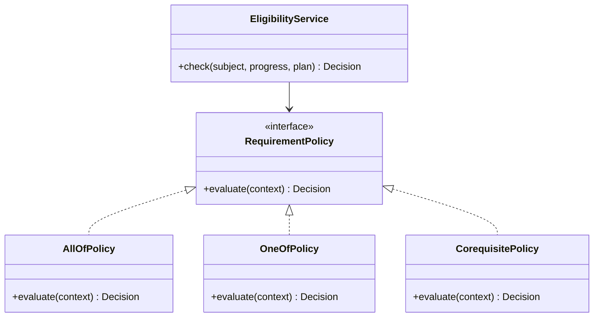

# Padrões e reutilização

A referência do AQUI TEM FCTE inspira o registro de padrões, componentes reutilizáveis e evolução arquitetural. No KEPLER, um padrão só é adotado quando resolve um problema identificado e sua consequência pode ser verificada.

## Catálogo de decisões

| Padrão | Problema atendido | Aplicação no KEPLER | Situação |
|---|---|---|---|
| Repository | domínio não deve depender de SQL ou estado global | contratos para currículo, ofertas, progresso e planos | Proposto |
| Strategy | regras variam conforme currículo ou tipo de requisito | estratégias para `all_of`, `one_of`, pré e correquisito | Proposto |
| Adapter | fontes acadêmicas possuem formatos distintos | adaptadores que convertem cada fonte ao modelo canônico | Proposto |
| Factory Method | seleção do importador depende da fonte e versão | fábrica de parsers e validadores de importação | Proposto |
| Facade | a interface não deve coordenar várias regras | serviço de planejamento reúne progresso, requisito e conflito | Proposto |
| Observer | visões derivadas precisam reagir ao mesmo estado | atualização de progresso, grade e indicadores na interface | Parcial no protótipo |
| Component Composition | elementos visuais repetidos precisam de comportamento consistente | cartões, filtros, modais, badges e estados de carregamento | Em uso, a consolidar |

## Exemplo: estratégias de requisito



Cada decisão retorna resultado e motivos estruturados. Isso permite explicar a regra ao estudante e usar o mesmo comportamento na API e nos testes.

## Reutilização por nível

| Nível | Ativos reutilizáveis | Regra de dependência |
|---|---|---|
| Design | cores semânticas, tipografia, espaçamento e movimento | tokens não conhecem páginas |
| Interface | botões, campos, cartões, modais, tabela e mensagens | componentes não acessam banco |
| Aplicação | casos de uso de currículo, progresso e planejamento | não dependem de renderização |
| Domínio | intervalos, requisitos, elegibilidade e progresso | funções determinísticas quando possível |
| Dados | cliente HTTP, DTOs, repositórios e importadores | adaptam tecnologia ao domínio |

## Estrutura alvo

```text
frontend/src/
├── app/                 # composição, rotas e provedores
├── features/            # currículo, progresso, ofertas e grade
├── components/          # elementos reutilizáveis
├── domain/              # regras puras e tipos acadêmicos
├── services/            # cliente de API e casos de uso
└── styles/              # tokens e fundamentos visuais

backend/
├── api/                 # rotas e contratos HTTP
├── application/         # casos de uso
├── domain/              # entidades e políticas
├── infrastructure/      # banco, identidade e importadores
└── tests/
```

## Critérios para adotar um padrão

1. existe variação, acoplamento ou duplicação observável;
2. a alternativa mais simples já ficou insuficiente;
3. o padrão reduz dependências ou torna uma regra testável;
4. os custos de abstração e manutenção foram registrados;
5. um teste ou cenário demonstra a consequência esperada.

Padrões sem uso concreto não entram no catálogo como implementados. Singleton, Abstract Factory, Decorator e outros padrões podem ser avaliados futuramente, mas não são requisitos de quantidade.

## Plano de refatoração

1. extrair chamadas HTTP e tipos do componente principal;
2. consolidar tokens e componentes usados em mais de uma tela;
3. isolar regras de horário e elegibilidade em módulos puros;
4. criar fachadas de caso de uso na API;
5. introduzir repositórios com implementação em memória para transição;
6. substituir a implementação por PostgreSQL sem alterar o domínio;
7. registrar decisões relevantes em ADRs curtos.
