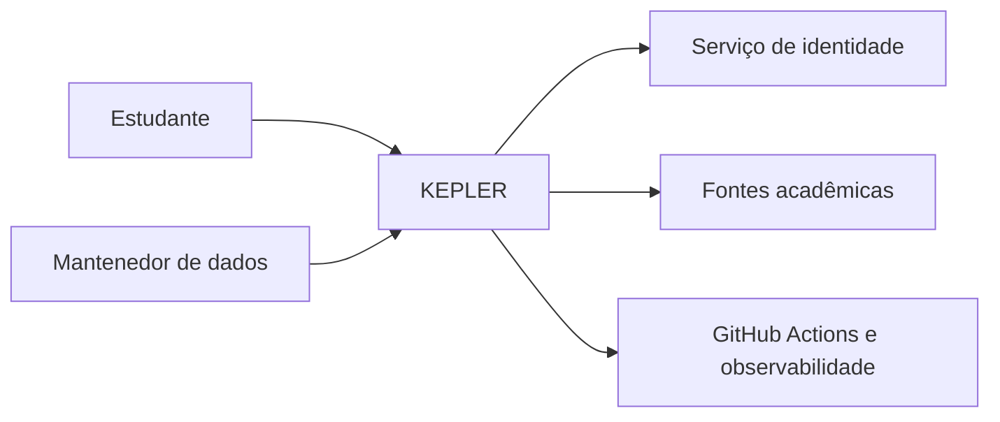
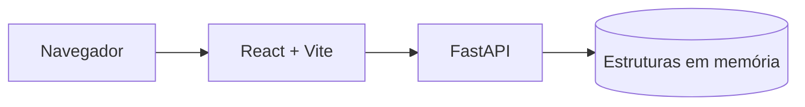
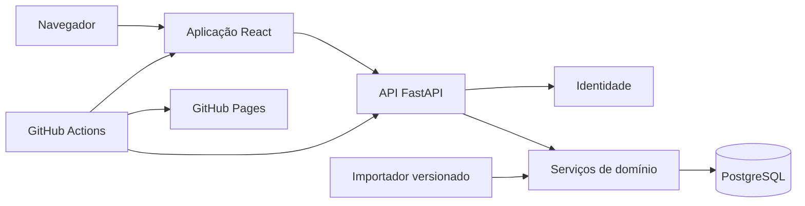

# Arquitetura

Esta é a visão central da arquitetura do KEPLER. Ela distingue o que está **implementado no protótipo** do que foi **proposto como arquitetura alvo**.

## Estado das decisões

| Elemento | Situação | Evidência ou decisão necessária |
|---|---|---|
| React 19, TypeScript e Vite | Implementado | código em `frontend/` |
| API FastAPI | Implementada como protótipo | código em `backend/main.py` |
| Estado compartilhado em memória | Implementado apenas para demonstração | deve ser substituído antes do uso multiusuário |
| PostgreSQL e migrações | Proposto | validar stack e criar migração inicial |
| Autenticação e isolamento por usuário | Propostos | definir provedor e políticas de acesso |
| Importação versionada | Proposta | definir fontes oficiais e formato canônico |
| GitHub Pages para documentação | Implementado | workflow de documentação |

## Contexto do sistema

O estudante consulta o currículo, registra progresso, verifica elegibilidade e monta a grade. O mantenedor publica dados acadêmicos com origem identificada. Os serviços externos fornecem identidade, dados e operação da plataforma.

## Contêineres atuais

O estado do backend é global ao processo. Reiniciar o serviço perde alterações, e usuários diferentes não têm isolamento. Essa solução atende à demonstração visual, mas não atende aos requisitos de segurança, persistência e rastreabilidade.

## Contêineres alvo

## Direcionadores de qualidade

| Direcionador | Consequência arquitetural |
|---|---|
| Correção acadêmica | regras puras, explicações estruturadas e testes por combinação |
| Privacidade | identidade no servidor, isolamento no banco e logs sem dados sensíveis |
| Rastreabilidade | fonte, versão, vigência e evidências ligadas ao commit |
| Desempenho percebido | respostas incrementais, cache controlado e operações fora da renderização |
| Manutenibilidade | camadas com dependência dirigida ao domínio e contratos estáveis |
| Acessibilidade | componentes consistentes, teclado, foco e estados anunciados |

## Responsabilidades

- **interface:** apresenta dados, estados e intenções do usuário;
- **aplicação:** coordena cada caso de uso e sua transação;
- **domínio:** calcula conflitos, elegibilidade e progresso sem depender de UI ou banco;
- **servidor:** valida identidade, autorização e contratos de entrada;
- **persistência:** garante integridade, unicidade, vigência e isolamento;
- **importação:** normaliza fontes e produz relatório transacional;
- **CI/CD:** verifica, empacota, publica e preserva evidências.

## Regras arquiteturais

1. conflito e elegibilidade vivem em módulos puros e testáveis;
2. a mesma fonte de progresso alimenta todas as visões derivadas;
3. operações pessoais verificam identidade no servidor e no banco;
4. importações não deixam gravações parciais sem relatório;
5. currículos, requisitos e ofertas preservam fonte, versão e vigência;
6. a API retorna motivos estruturados para decisões acadêmicas;
7. mudanças estruturais relevantes recebem um ADR.

## Caminho de migração

1. modularizar o frontend e extrair as regras do componente principal;
2. criar contratos de repositório e testes de domínio;
3. introduzir PostgreSQL, migrações e dados de referência;
4. adicionar identidade e isolamento dos dados pessoais;
5. migrar progresso e planejamento para serviços persistentes;
6. implantar importação versionada e observabilidade;
7. promover o sistema após validar qualidade e rollback.

## Modelos relacionados

- [Modelagem estática](../arquitetura/modelagem-estatica.md)
- [Modelagem dinâmica](../arquitetura/modelagem-dinamica.md)
- [Modelagem de dados](../arquitetura/modelagem-dados.md)
- [Padrões e reutilização](../arquitetura/padroes-reutilizacao.md)
- [Integração e entrega contínuas](../arquitetura/ci-cd.md)

!!! warning "Decisão pendente"
    O blueprint também considera Next.js e Supabase. Como o protótipo já usa React/Vite e FastAPI, a documentação adota essa linha como hipótese de evolução. A decisão final deve ser registrada em ADR antes de consolidar banco, autenticação e implantação.
