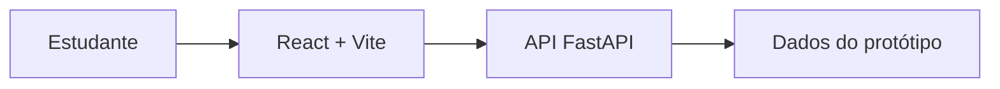
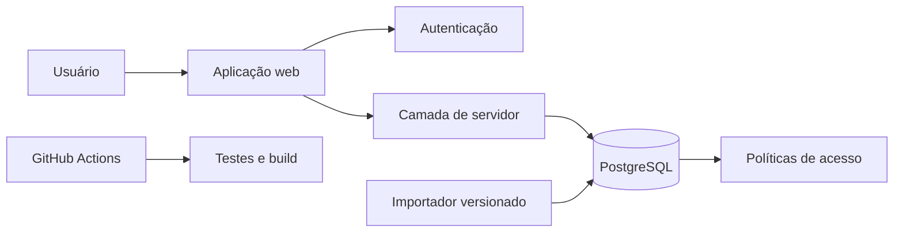

# Arquitetura

## Estado atual do protótipo

O código presente no repositório utiliza **React 19**, **TypeScript** e **Vite** no frontend, com uma API **FastAPI**. Essa composição permite validar rapidamente as interfaces e regras iniciais.

## Arquitetura alvo do blueprint

O blueprint propõe uma aplicação web com autenticação, banco relacional, regras de acesso por linha e importação versionada. A escolha final da stack deve ser registrada antes da consolidação do backend.

## Responsabilidades

- **interface:** apresenta dados, estados e intenções do usuário;
- **domínio:** calcula conflitos, elegibilidade e progresso sem depender da UI;
- **servidor:** valida autorização e coordena operações sensíveis;
- **persistência:** garante integridade, unicidade, vigência e isolamento;
- **importação:** normaliza fontes e produz relatório transacional;
- **CI:** executa tipos, qualidade, testes e build.

## Entidades centrais

| Grupo | Entidades |
|---|---|
| Identidade | perfil e curso do usuário |
| Currículo | curso, disciplina, currículo e requisitos |
| Oferta | período letivo, turma e encontros semanais |
| Progresso | estado pessoal, período real e tentativas |
| Planejamento | plano de estudo e ofertas selecionadas |

## Regras arquiteturais

1. conflito e elegibilidade vivem em módulos puros e testáveis;
2. a mesma fonte de progresso alimenta todas as suas visões;
3. operações pessoais verificam identidade no servidor e no banco;
4. importações não deixam gravações parciais sem relatório;
5. currículos e ofertas preservam fonte, versão e vigência;
6. mudanças estruturais relevantes recebem um ADR.

!!! warning "Decisão pendente"
    O blueprint recomenda Next.js e Supabase, com React/Vite, FastAPI e PostgreSQL como alternativa. O protótipo segue a alternativa Python, mas isso ainda não equivale a uma decisão arquitetural definitiva.
