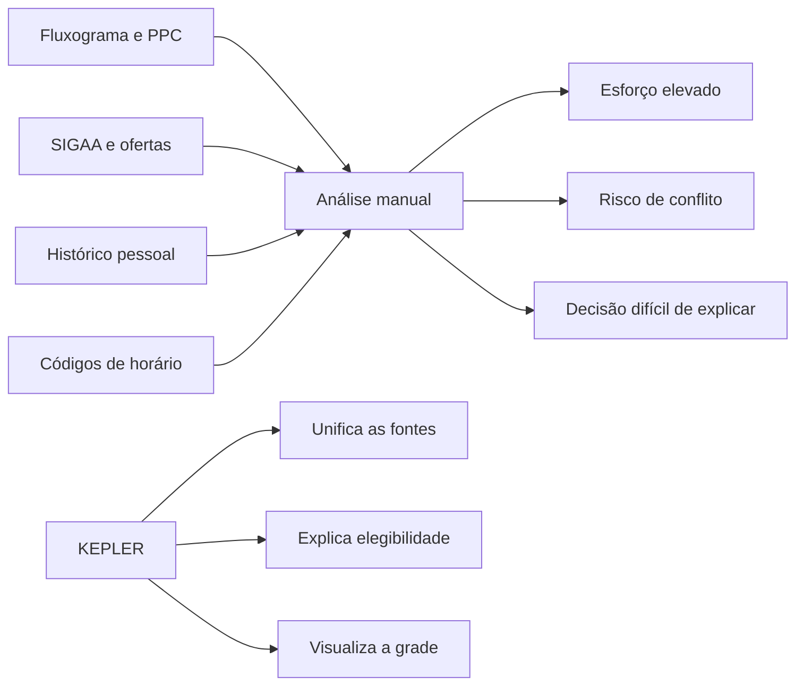
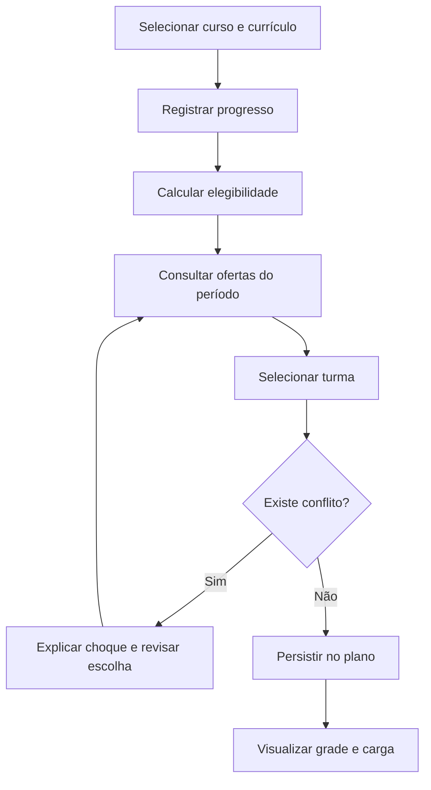

# Base e descoberta

Esta seção segue a progressão usada pelo AQUI TEM FCTE: compreender o problema, divergir em alternativas, tomar decisões, prototipar e validar. Ela registra evidências disponíveis sem apresentar atividades planejadas como concluídas.

## Estado dos artefatos

| Estado | Significado |
|---|---|
| Documentado | Existe evidência no blueprint, protótipo ou repositório. |
| Em validação | A hipótese está representada, mas precisa de avaliação com estudante. |
| Planejado | A atividade e a evidência ainda precisam ser executadas. |

## Design Sprint adaptado

| Etapa | Aplicação no KEPLER | Estado | Evidência |
|---|---|---|---|
| Mapping | Jornada de currículo, progresso, oferta e grade | Documentado | Visão, personas e blueprint |
| Sketch | Alternativas de fluxo e cinco telas principais | Documentado | Protótipos e arquivos Figcraft locais |
| Decide | Recorte do MVP e princípios de explicabilidade | Documentado | Escopo e requisitos priorizados |
| Prototype | Interface React/Vite conectada à API FastAPI | Documentado | Protótipo executável |
| Test | Tarefas com estudantes iniciantes, irregulares e concluintes | Planejado | Roteiro e relatório de usabilidade |

## Mapa do problema

## Diagrama de causa e efeito

| Dimensão | Causas observadas ou hipotéticas |
|---|---|
| Informação | Fontes separadas, vigências diferentes e códigos compactos |
| Processo | Comparação manual e repetida a cada semestre |
| Regra | Pré-requisitos, correquisitos e conflitos combinados |
| Pessoa | Diferentes níveis de experiência com o currículo |
| Ferramenta | Fluxogramas estáticos e planilhas sem validação automática |
| Resultado | Grade incoerente, tempo perdido ou decisão sem confiança |

## 5W2H do produto

| Pergunta | Resposta |
|---|---|
| What | Planejador acadêmico de currículo, progresso, ofertas e grade |
| Why | Reduzir esforço e tornar decisões acadêmicas explicáveis |
| Who | Estudantes da FGA/UnB e administradores de dados |
| Where | Aplicação web responsiva |
| When | Preparação e revisão do planejamento semestral |
| How | Dados versionados, regras de domínio e visualização semanal |
| How much | Esforço incremental; custos dependem da hospedagem escolhida |

## Léxico do domínio

| Termo | Definição usada pelo projeto |
|---|---|
| Currículo | Versão vigente da estrutura de um curso. |
| Disciplina | Unidade curricular identificada por código institucional. |
| Oferta | Turma de uma disciplina em um período letivo. |
| Encontro | Intervalo semanal de uma oferta em um dia específico. |
| Progresso | Estado pessoal do estudante em relação a uma disciplina. |
| Elegibilidade | Resultado explicável das regras para cursar uma disciplina. |
| Plano de estudos | Conjunto de ofertas escolhido para um período. |
| Conflito | Sobreposição temporal entre encontros selecionados. |
| Vigência | Intervalo em que um dado acadêmico é aplicável. |

## Processo de planejamento

## Evidências ainda necessárias

- entrevistas com estudantes de perfis diferentes;
- teste comparativo de montagem de grade;
- validação das regras com fonte institucional;
- registro de decisões após cada sessão;
- métricas de tempo, sucesso, erro e compreensão.
