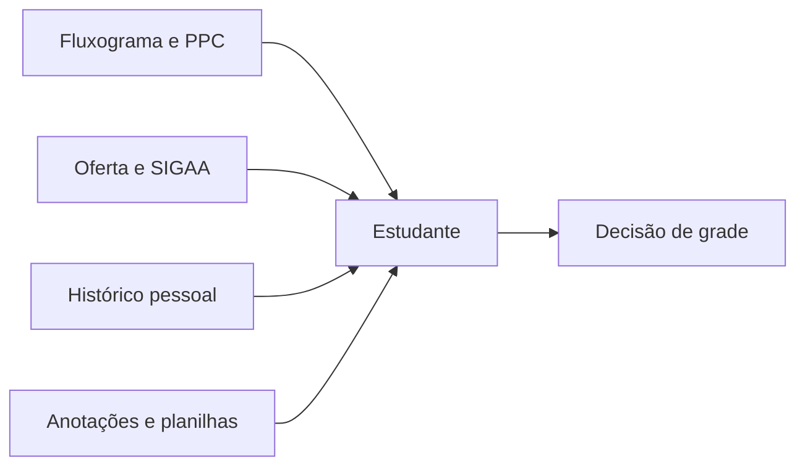

# Cenário e stakeholders

## Cenário atual

O planejamento semestral combina informações com formatos e vigências diferentes. O estudante precisa interpretar o fluxo curricular, conferir pré-requisitos, localizar ofertas e decodificar horários antes de comparar as combinações possíveis.

## Stakeholders

| Stakeholder | Interesse | Participação esperada |
|---|---|---|
| Estudantes da FGA | Planejar o semestre com clareza e evitar conflitos | Descoberta, testes de usabilidade e validação |
| Equipe do KEPLER | Entregar um produto coerente, seguro e sustentável | Produto, requisitos, desenvolvimento e qualidade |
| Coordenações de curso | Representação correta do currículo vigente | Validação de fontes e regras curriculares |
| Administração de dados | Importar e corrigir catálogo, ofertas e vigências | Operação e auditoria de dados |
| Docentes da disciplina | Avaliar processo, artefatos e evolução | Acompanhamento acadêmico |

## Fontes de informação

As fontes previstas são:

1. Projeto Pedagógico do Curso e fluxogramas institucionais;
2. SIGAA e oferta oficial do período;
3. catálogo legado do KEPLER, após validação;
4. blueprint do produto;
5. observação e testes com estudantes.

Em caso de divergência, uma fonte institucional vigente tem precedência. A divergência deve permanecer registrada para análise.

## Restrições conhecidas

- o KEPLER não confirma matrícula nem disponibilidade de vaga;
- a confiabilidade depende da vigência e procedência do catálogo importado;
- regras curriculares variam entre cursos e versões de currículo;
- entrevistas e testes ainda precisam ser registrados como evidência, sem presumir resultados.
