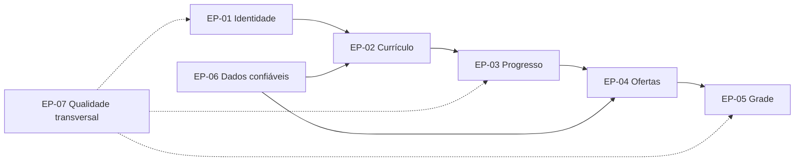

# Épicos

Os épicos agrupam resultados de produto. Cada um possui objetivo, valor, escopo, critério de sucesso e histórias relacionadas.

## Mapa dos épicos

## EP-01 — Identidade e perfil

**Objetivo:** oferecer acesso individual e contextualizar a experiência pelo curso do estudante.

**Valor:** preservar progresso e planos pessoais com privacidade.

**Inclui:** cadastro, sessão, recuperação, curso, perfil e isolamento de dados.

**Critério de sucesso:** dois usuários usam o sistema sem conseguir consultar ou alterar dados um do outro.

**Histórias:** US-01 a US-05.

## EP-02 — Currículo compreensível

**Objetivo:** apresentar a estrutura curricular do curso de forma navegável.

**Valor:** reduzir a consulta manual a múltiplos documentos para entender disciplinas e relações.

**Inclui:** disciplinas por semestre, informações acadêmicas, pré-requisitos e dependências.

**Critério de sucesso:** o estudante localiza uma disciplina e explica o que a precede e o que ela libera.

**Histórias:** US-06 e US-07.

## EP-03 — Progresso e elegibilidade

**Objetivo:** representar a trajetória real e explicar quais disciplinas podem ser cursadas.

**Valor:** apoiar estudantes cujo percurso não segue exatamente o fluxo recomendado.

**Inclui:** estados, percentual, créditos, semestre real, tentativas, visões derivadas e elegibilidade.

**Critério de sucesso:** uma alteração de progresso atualiza todas as visões e justificativas de forma coerente.

**Histórias:** US-08 a US-13.

## EP-04 — Descoberta de ofertas

**Objetivo:** tornar o catálogo do período pesquisável e comparável.

**Valor:** diminuir o esforço para localizar turmas compatíveis com as preferências do estudante.

**Inclui:** período letivo, busca, filtros, professor e encontros semanais.

**Critério de sucesso:** o estudante encontra uma turma específica usando filtros combinados e consulta todos os encontros.

**Histórias:** US-14 a US-16.

## EP-05 — Planejamento da grade

**Objetivo:** montar uma grade semanal válida, explicável e persistente.

**Valor:** identificar incompatibilidades antes que o estudante finalize seu planejamento.

**Inclui:** adição, duplicidade, conflito, remoção, persistência, visão semanal e carga total.

**Critério de sucesso:** a grade sinaliza todos os encontros conflitantes e reaparece em uma nova sessão.

**Histórias:** US-17 a US-23.

## EP-06 — Governança de dados acadêmicos

**Objetivo:** manter catálogo, currículo e oferta auditáveis.

**Valor:** permitir que o estudante saiba de qual período e fonte veio uma informação.

**Inclui:** importação, validação, relatório, fonte, versão e vigência.

**Critério de sucesso:** toda importação encerra com relatório e não grava um lote parcialmente inválido.

**Histórias:** US-24 a US-27.

## EP-07 — Qualidade transversal

**Objetivo:** garantir que as jornadas sejam seguras, acessíveis, responsivas e verificáveis.

**Valor:** permitir uso confiável em dispositivos e contextos diferentes.

**Inclui:** TypeScript estrito, RLS, segredos, mobile, teclado, contraste, erros, migrações, CI, logs e testes.

**Critério de sucesso:** todos os gates automatizados passam e a jornada crítica funciona a partir de 360 px e por teclado.

**Itens:** HT-01 a HT-06 e RNF-001 a RNF-012.
