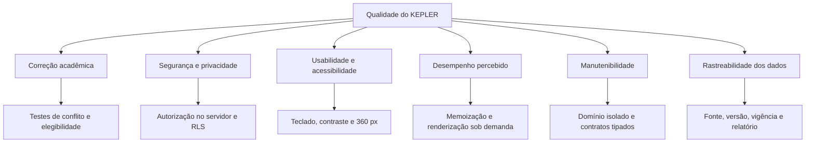

# NFR Framework

O NFR Framework representa requisitos de qualidade como **softgoals**, suas operacionalizações e contribuições. A estrutura segue a referência do CHEF Indica e explicita decisões e conflitos do KEPLER.

## Softgoals prioritários

## Contribuições e trade-offs

| Decisão | Contribui para | Pode prejudicar | Tratamento |
|---|---|---|---|
| Validar conflitos antes de salvar | Correção, confiança | Latência | Regra pura e cálculo incremental |
| Carregar detalhes sob demanda | Desempenho | Imediatismo offline | Cache da sessão e estado de carregamento |
| Manter histórico de vigência | Rastreabilidade | Complexidade do modelo | Migrações e consultas encapsuladas |
| Aplicar RLS em registros pessoais | Privacidade | Complexidade operacional | Políticas testadas com dois usuários |
| Mostrar explicações completas | Compreensão | Densidade visual | Divulgação progressiva e resumo inicial |
| Animar fluxos e livros | Orientação espacial | Desempenho, acessibilidade | `prefers-reduced-motion` e transformações baratas |

## Cartões de especificação

### NFR-COR — Correção acadêmica

| Campo | Especificação |
|---|---|
| Descrição | Conflitos e elegibilidade devem produzir resultados corretos e explicáveis. |
| Origem | Princípios do produto, RF-015 e RF-025 |
| Prioridade | Crítica |
| Operacionalização | Funções puras, catálogo validado e testes determinísticos |
| Critério | Todos os casos limítrofes definidos passam na CI |
| Conflito | Mais validação pode aumentar o tempo de resposta |
| Evidência | Testes unitários, integração e E2E |

### NFR-SEC — Segurança e privacidade

| Campo | Especificação |
|---|---|
| Descrição | Usuários acessam somente perfil, progresso e planos próprios. |
| Origem | RF-006, RNF-002 e RNF-003 |
| Prioridade | Crítica |
| Operacionalização | Sessão segura, autorização de servidor, RLS e gestão de segredos |
| Critério | Tentativas cruzadas são negadas em leitura e escrita |
| Conflito | Proteções adicionais elevam custo de desenvolvimento e teste |
| Evidência | Suite com dois usuários e inspeção de políticas |

### NFR-USA — Usabilidade e acessibilidade

| Campo | Especificação |
|---|---|
| Descrição | Regras complexas devem ser compreensíveis por teclado, mobile e tecnologias assistivas. |
| Origem | Personas, RNF-004 a RNF-007 |
| Prioridade | Alta |
| Operacionalização | Foco visível, semântica, contraste AA, mensagens claras e lista alternativa à grade |
| Critério | Jornada principal concluída em 360 px e sem mouse |
| Conflito | Visualizações densas exigem alternativas responsivas |
| Evidência | Auditoria manual, axe e teste de tarefa |

### NFR-PER — Desempenho percebido

| Campo | Especificação |
|---|---|
| Descrição | Navegação e abertura de detalhes não devem bloquear a interface. |
| Origem | Uso do protótipo e tela Atlas/livros |
| Prioridade | Alta |
| Operacionalização | Memoização, componentes sob demanda, contenção de layout e animações por transform |
| Critério | Metas NFR-P01 e NFR-P02 da especificação suplementar |
| Conflito | Pré-carregar tudo aumenta memória e custo inicial |
| Evidência | Performance trace e métricas Web Vitals |

### NFR-TRA — Rastreabilidade

| Campo | Especificação |
|---|---|
| Descrição | Decisões e dados acadêmicos devem manter origem e evolução. |
| Origem | RF-033 e RNF-012 |
| Prioridade | Alta |
| Operacionalização | Metadados de fonte, vigência, histórico e ADRs |
| Critério | Nenhum lote vigente existe sem fonte identificável |
| Conflito | Histórico aumenta armazenamento e consultas |
| Evidência | Relatório de importação e auditoria de metadados |

## Propagação da decisão

Uma decisão só pode ser marcada como satisfatória quando existe evidência. Os estados utilizados são: **satisfeito**, **parcialmente satisfeito**, **indeterminado**, **parcialmente negado** e **negado**. Enquanto o backend usar dados globais em memória, segurança, persistência e rastreabilidade permanecem **indeterminadas ou não satisfeitas** no produto real, mesmo que estejam especificadas.
