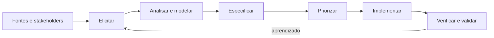

# Processo de requisitos

## Estratégia

O processo combina descoberta contínua e desenvolvimento incremental. Cada requisito deve manter vínculo com uma necessidade, uma fonte e uma forma de verificação.

## Técnicas

| Técnica | Situação | Resultado esperado |
|---|---|---|
| Análise documental | Em uso | Regras extraídas do blueprint, PPC, fluxogramas e oferta |
| Inspeção do legado | Em uso | Conceitos reaproveitáveis e problemas a evitar |
| Prototipação | Em uso | Fluxos navegáveis para tornar decisões concretas |
| Entrevista semiestruturada | Planejada | Dores, vocabulário e prioridades dos estudantes |
| Teste de usabilidade | Planejado | Evidência sobre compreensão e eficiência das jornadas |
| Workshop de validação | Planejado | Acordo sobre regras, escopo e critérios de aceite |

## Ciclo de uma mudança

1. registrar a necessidade e sua origem;
2. analisar impacto, dependências e riscos;
3. escrever comportamento e critérios de aceite;
4. priorizar no backlog;
5. implementar um incremento observável;
6. verificar por teste e validar com stakeholder;
7. atualizar documentação e rastreabilidade.

## Definition of Ready

Um item está pronto para desenvolvimento quando possui:

- problema ou necessidade identificada;
- resultado observável;
- critérios de aceite verificáveis;
- dependências e regras relevantes;
- prioridade acordada;
- tamanho compatível com um incremento.

## Gestão de mudanças

Mudanças que alterem escopo, arquitetura ou regra acadêmica devem atualizar o requisito, a matriz de rastreabilidade e o backlog. Decisões arquiteturais de maior impacto devem ser registradas como ADR no repositório.
